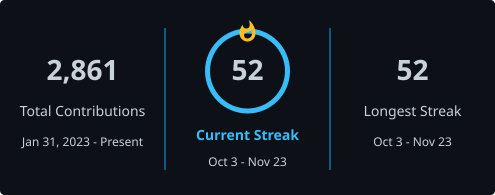
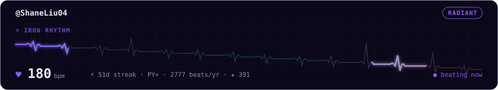
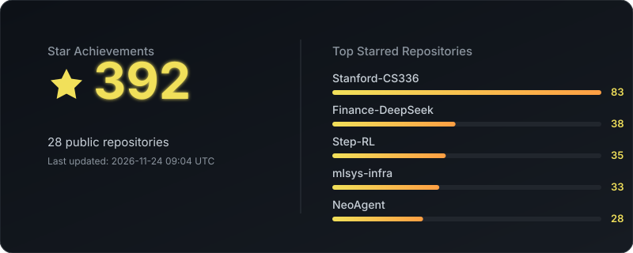

> ### **聚焦端侧模型、AI Infra 与 Agent 系统架构，为物理智能体筑牢底座，构建万物互联的智能世界**

  
  

  

  <picture>
    <source media="(prefers-color-scheme: dark)" srcset="https://raw.githubusercontent.com/ShaneLiu04/ShaneLiu04/output/github-contribution-grid-snake-dark.svg" />
    <source media="(prefers-color-scheme: light)" srcset="https://raw.githubusercontent.com/ShaneLiu04/ShaneLiu04/output/github-contribution-grid-snake.svg" />
    
  </picture>

  
★

  

    
  

