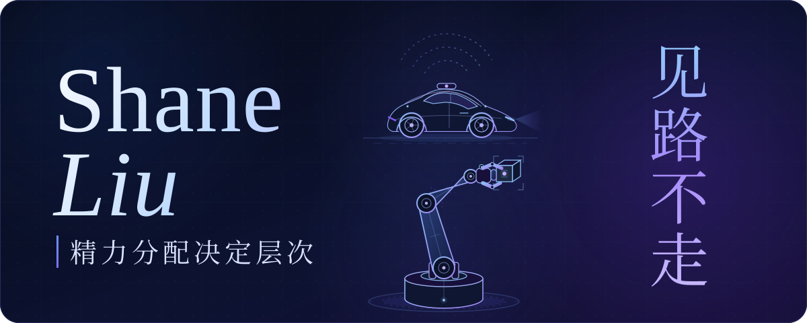
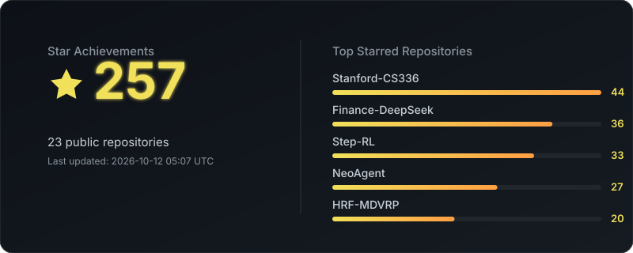

  

  <i>聚焦端侧模型、AI Infra 与 Agent 基础设施，为物理智能体筑牢底座，构建万物互联的智能世界。</i>

## <samp>01</samp> — Stack

**On-device AI** 
       
    

**AI Infra** 
       
       

**Agent** 
       
      

## <samp>02</samp> — Stats

  
  

  <picture>
    <source media="(prefers-color-scheme: dark)" srcset="https://raw.githubusercontent.com/ShaneLiu04/ShaneLiu04/output/github-contribution-grid-snake-dark.svg" />
    <source media="(prefers-color-scheme: light)" srcset="https://raw.githubusercontent.com/ShaneLiu04/ShaneLiu04/output/github-contribution-grid-snake.svg" />
    
  </picture>

  
Star achievements

  

    
  

